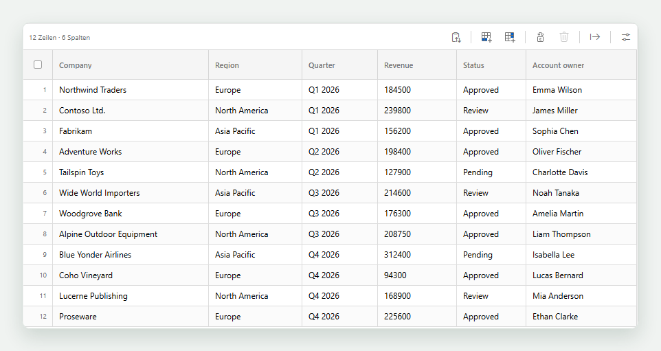
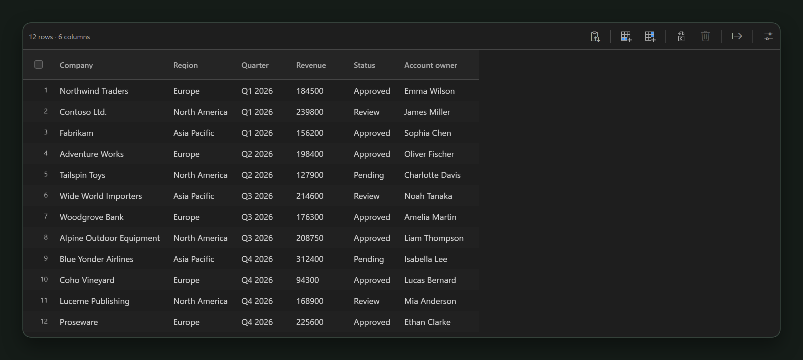

# CSV Simple Editor

View and edit CSV and TSV files as tables in Visual Studio Code. CSV Simple Editor detects delimiters, keeps your data in the same editor tab, and makes sorting, filtering, editing, and importing rows quick.

### Light appearance

### Dark appearance

## Features

- Automatically detects commas, semicolons, tabs, and pipes, and preserves the delimiter when saving.
- Opens CSV and TSV files in a table in the same editor tab.
- Sizes columns to their contents; drag a column edge to resize it, or double-click the edge to restore automatic sizing.
- Sorts columns from the header or context menu; filter each column from its header icon.
- Selects a column from its context menu and highlights it in the table.
- Moves columns using the grip at the left of each heading, arrow keys on the focused grip, or the column context menu.
- Selects cell ranges by clicking and dragging; drag across column headings or the original row number (ID) strip to select whole columns or rows. Selection scrolls automatically at the table edges.
- Exports the current filtered and sorted view as CSV or PDF from the toolbar export menu.
- Keeps original row numbers visible when the table is sorted.
- Uses VS Code's native Find (`Ctrl+F` / `Cmd+F`) across table rows.
- Edits cells with a double-click, `Enter`, or `F2`; `Tab` moves to the next cell.
- Moves between cells with the arrow keys; `Home` and `End` jump to the first and last cell in a row.
- Copies individual cells or rows as tab-separated values; copy a row or the visible column as a newline-separated list from its heading.
- Optionally colorizes columns with colors from the active VS Code theme. CSV files do not store cell colors.
- Optionally shows subtle gridlines between table rows and columns.
- Lets you choose whether CSV and TSV files open in the table by default from the table settings or VS Code's extension settings.
- Adds rows and columns; the column menu can insert before or after selected columns or append at the end. Deletes selected rows or individual columns.
- Replaces exact cell values across the table or selected columns from the toolbar menu.
- Offers ten interface languages and System, Light, or Dark appearance settings.
- Syncs edits with the regular VS Code document. Save with `Ctrl+S` / `Cmd+S`.
- Changes the delimiter and clears filters or sorting from the Tools menu. CSV options, language, and appearance are grouped in settings.
- Shows import validation details on demand, with distinct subtle colors for warnings and errors.

## Usage

Responsive columns are enabled by default. Automatically sized columns use available editor space and shrink only until every value and header still fits; narrower views scroll horizontally. Disable Fit columns to available width in settings to keep natural content widths. Manual widths are preserved; use Reset column widths to return to automatic sizing. The Appearance setting follows the VS Code theme by default, or lets you choose Light or Dark independently. These preferences are shared across files and sessions.

Automatic column widths fit the header, filter control, and the widest cell value using the actual display font. Drag a column's right header edge to resize it independently, down to 40px. Headers and values that no longer fit end in an ellipsis; their full contents remain intact. Manual widths persist across edits and view reloads. Double-click the header edge to restore automatic sizing for that column, or use Reset column widths in settings to reset them all.

Column filters list the distinct values with checkboxes and occurrence counts, including blank cells. Search narrows the list and applies a case-insensitive contains condition; the checked values further restrict the result by exact value. Search and selection changes apply immediately, and Escape or clicking outside closes the filter without undoing them. Other active column filters determine the available values. Long lists load in batches via Show more values, and search covers the entire list. Use Clear filter to reset a column, or Clear filters in Table settings to reset every column.

Click and drag from a cell to select a rectangular range. Start on the original row number to select rows, or drag across column headings to select columns. Hold Ctrl / Cmd when selecting row or column headings to add or remove them. A single click on a column name continues to sort. Ctrl+C / Cmd+C copies the selected cells, rows, or columns as tab-separated data, and Escape clears the selection. Move a column with its heading grip, or use Move column left / right in its context menu. Moving columns changes their order in the CSV document and can be undone with VS Code's Undo command.

Use the export icon in the top toolbar and choose CSV / PDF to save a separate file with all rows matching the current filters, in the current sort and column order. Exports include column names and all matching rows, including rows outside the visible viewport, and ignore cell/row selections. CSV preserves the configured delimiter, BOM, and line endings. PDF 1.7 exports contain real text that can be selected, copied, and searched, with embedded font subsets and vector table lines. The light print layout uses automatically sized columns, wrapped text, and portrait or landscape A4 pages. Very wide tables continue in column groups, and long values continue across pages with repeated headings. Noto Sans and a fallback font cover Latin, Greek, Cyrillic, Chinese/Japanese and Korean characters. Characters unavailable in the bundled fonts produce an explicit export error. Exceptionally long PDF headings are shortened after eight lines; CSV retains their full contents.

Use the Replace values toolbar menu to choose the whole table or selected columns, then replace an exact cell value. Matching is case-sensitive, and column headers are left unchanged. The operation updates the CSV document as one edit, which can be undone with VS Code's Undo command.

Paste CSV or tab-separated data into an empty file with `Ctrl+V` / `Cmd+V` to create a table immediately (the first row becomes the column names). The clipboard toolbar button also reads the clipboard. With an existing table, a preview lets you append rows or replace the table, select a delimiter, import with or without column names, skip empty rows, and remove exact duplicate rows across the resulting table.

When appending with column names, columns are matched by name, ignoring surrounding whitespace and letter case, so reordered columns are placed correctly. Missing, unknown, empty or duplicate column names, inconsistent record widths, and malformed quoted fields block the import until corrected. Validation details appear on the information icon when you hover or focus it; warnings use a subtle yellow state and errors a subtle red state. The preview shows the first five incoming rows and the resulting row count. Imports include all rows, regardless of active filters; importing clears sorting and filters. Undo the import with VS Code's normal Undo command.

Open a `.csv` or `.tsv` file to start in table view. Click a column heading to sort; click its filter icon to filter. Right-click a cell or heading for more actions. Use the editor title action to switch back to the text view.

The table follows the active VS Code color theme and keeps the toolbar compact. Settings group tools, CSV options, file handling, and interface preferences. The toolbar provides quick access to value replacement. The project section links to change requests and shows the installed extension version.

## Development

The extension needs no runtime npm installation. The PDF engine (pdf-lib/fontkit) and fonts are bundled in `media/pdf` with their licenses and source checksums, and load only when PDF export is used. Fonts use lossless gzip compression and are decompressed on demand with built-in APIs; their original character coverage is preserved. Exports work offline. Run `npm test` for the CSV, PDF, and extension regression tests, and `npm run package` on Windows to build the VSIX. Packaging includes runtime assets and licenses, and embeds README screenshots once; source artwork and separate screenshots stay in the repository. The editable logo is in `media/csv-simple-editor-favicon.svg`; `media/extension-icon.png` is the raster version used by the Marketplace.

Optional browser checks use Playwright with its Chromium browser installed: run `npm run test:ui`. If Playwright is installed in another workspace, pass its module path with `npm run test:ui -- D:/path/to/node_modules/playwright`. In environments that restrict child processes, run the dependency-free suite with `node --test --test-isolation=none`.

Independent PDF text extraction checks use PDF.js: run `npm run test:pdf`, or pass its module entry path with `npm run test:pdf -- D:/path/to/node_modules/pdfjs-dist/legacy/build/pdf.mjs`. Run `node scripts/update-pdf-assets.cjs` only when intentionally refreshing bundled PDF assets, then review the generated checksums and licenses.

Regenerate the light and dark overview screenshots with `node scripts/capture-screenshots.cjs`, optionally passing an existing Playwright module path. Captures use the actual editor, bundled fonts and icons, natural column widths, and closed menus. The README references the PNG files in `media`; packaging embeds these images into the extension's README so they also display offline after installing the VSIX.
